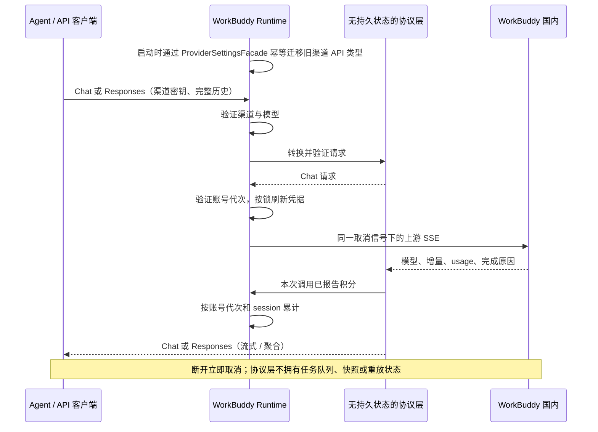
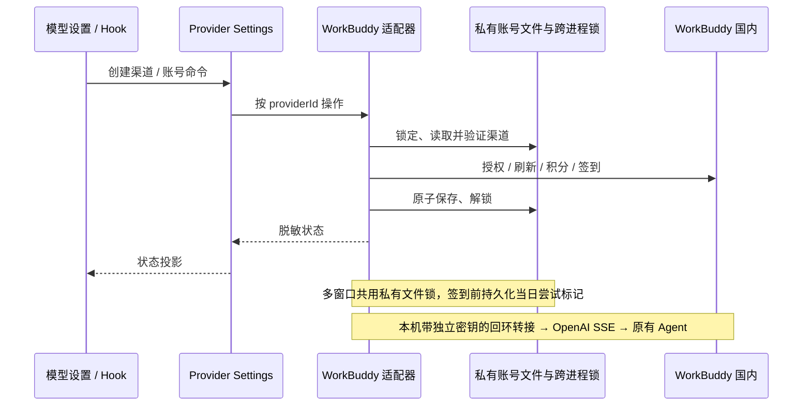
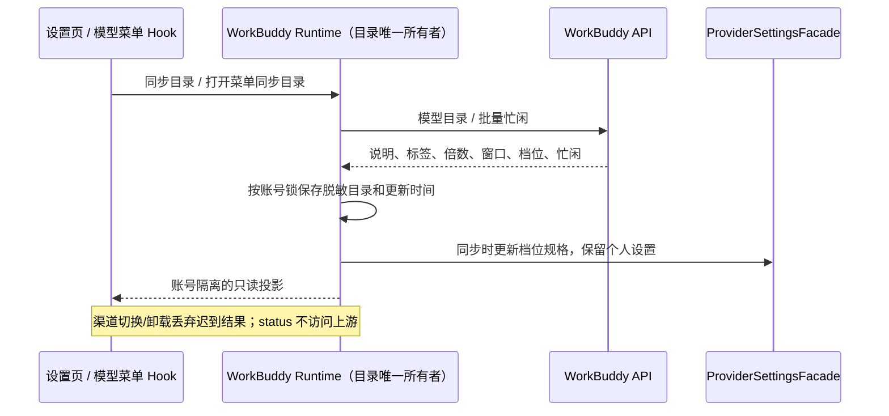
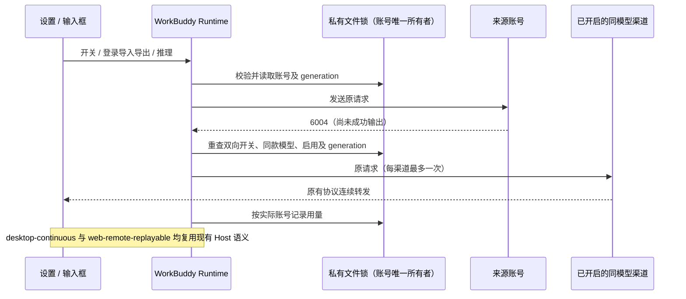

# WorkBuddy 国内渠道

## 产品规则

模型设置的「添加供应商」增加 WorkBuddy（国内）。可重复添加，名称可修改，每个供应商对应独立账号。详情提供浏览器授权登录、取消登录、退出账号、刷新账号与积分、积分包到期信息、签到状态和手动签到，以及模型同步与启用选择。

登录成功和手动刷新时通过国内 `/v2/accounts` 读取个人账号资料，显示昵称和账号 ID，与可编辑的渠道名称分别展示；资料读取失败保留已知昵称并提示刷新，不让资料失败阻断登录或积分读取。状态轮询仅读缓存，不增加用户资料或余额网络轮询。退出和切换账号清除旧资料。

直接内置国内协议，不启动或调用 apiredirect，不提供国际区、Qoder 或外部管理 API。Provider Config 新增可选的 `integration: "workbuddy-cn"`，标识本地集成，不伪造 Built-in Template 身份。同步优先使用官方客户端的国内在线目录及 `credits` 倍数字段；失败保留已有目录，没有目录时才使用明确标注的快照。登录后补充目录，同步保留已有模型设置和禁用状态。

生成流的 `usage.credit` 是扣费事实，按 `x-session-id` 累计，在输入工具栏显示。重复 usage 事件只更新本次调用的已报告值；缺失积分的请求明确标记合计不完整。模型倍数不构成完整算法，不按 token 或余额差值猜扣费，不因推理主动查询余额。账号文件复用现有凭据加密器。

在线模型的 `contextWindow` 兼容数字和 `{ defaultLength, supportedLengths }`，取默认窗口进入模型配置。桌面与内嵌 Agent 必须一起重建并接受相同 Provider schema；发送回归需跨过 Agent 模型准入并收到合成响应，不能仅凭设置页展示或转接 HTTP 测试宣称完整链路通过。

桌面本地 Host 启动后台适配器，设置页关闭不影响运行，启动就绪不等待上游签到网络请求。在线且已启用的账号每天按北京时间自动尝试一次签到；启动/恢复后补查当天状态，关闭 ZCode 后不运行，也不补领过去日期。失败不盲目重发领取，允许手动刷新/签到。积分仅在登录、签到或手动刷新时查询，失败保留旧值并显示错误。

## 所有者与边界

### 推理协议兼容

内置上游快照 `vendor/wb-proxy.mjs` 与 `vendor/protocol.mjs`，直接调用原始 `handleChat` 和协议转换函数；前者仅添加实例工厂、鉴权与网络注入及禁用自动 CLI 入口，后者仅把两处 require 和 module.exports 转为 ESM 导入导出，协议函数体原样保留。桌面 Host 使用 ESM 打包，两种打包格式都必须实际加载运行，防止 CommonJS 内置模块引用在 Host 启动时触发 Dynamic require。`worker.js` 的接入流程由外侧 `transport.ts` 对接。更新说明和原始哈希位于 `vendor/README.md`，通过测试防止核心代码分叉。不依赖外部仓库或启动其进程。本机同时提供 `/v1/chat/completions`、`/v1/responses`，以及不带 `/v1` 的对应入口；WorkBuddy Provider 固定默认使用 Responses，与已验证正常的 apiredirect 接入一致。

已有 WorkBuddy 渠道若使用旧的 Chat Completions 配置，Runtime 启动时通过 ProviderSettingsFacade 将其 API 类型改为 `openai-responses`。迁移保留渠道 ID、名称、地址、密钥、账号、模型与启用状态；仅处理带 WorkBuddy integration 标识的个人渠道，成功后再次启动不写入。上游 Chat 分片中的空 `tool_calls: []` 不能作为思考分段边界；交给原始 Responses relay 按单个 reasoning item 聚合，SDK 应只产生一次 reasoning-start/end。不得在 UI 合并行掩盖错误，也不修改上游核心函数。

Runtime 唯一负责渠道密钥鉴权、启用模型准入、账号代次与刷新、请求取消和积分归属。协议层只做请求转换和当前请求的流聚合：Responses 完整 input 历史（文本、图片、函数调用与结果）转换为 Chat 请求；developer 归一为 system，缺少首条 system 时补默认提示，上游始终请求流式。拒绝服务端会话续接、后台响应、非函数工具及多个候选回答，返回 400，不静默丢弃。

转接在首次内容前验证上游模型等于请求模型或其日期后缀版本；错模型、缺少模型、事件截断、缺少完成原因或未知完成原因均失败。Responses 输出保留思考、文本、并行函数调用增量、完成事件和 token usage；length/content_filter 输出 incomplete。Chat 输出保留原始 usage.credit，两个入口共用现有积分去重统计。上游错误不输出原始内容，客户端断开中止上游。

此处只转换模型 HTTP 协议，不改变 desktop-continuous 或 web-remote-replayable 的 Host 事件语义。

验收：两种协议的流式与非流式文本、思考和多函数调用；Responses 图片与工具历史转换；非法输入 400 且不上游；错模型和截断失败；length 标记 incomplete；usage.credit 不重复累计；客户端断开取消上游。

WorkBuddy 适配器唯一管理账号凭据、待授权状态、刷新、积分缓存及每日自动签到标记。Provider Config 继续由现有 ProviderSettingsFacade 唯一写入，保存普通 OpenAI Responses 供应商和模型配置。RPC 增加可选的 WorkBuddy 命令接口；UI hook 调用它，不读文件或直接访问上游。

账号文件在 ZCode 配置目录，私有原子写入；不导入用户的 apiredirect 数据。每渠道独立回环密钥，上游令牌不进入 Provider Config；Renderer 仅在用户显式导出登录信息时短暂接收用于剪贴板复制。各 Host 共用持久化回环端口，只有成功绑定者服务；其它 Host 争用失败后等待并在原 Host 退出后接管。所有账号写操作共用文件锁，过期待授权不得覆盖新登录，删除后不能由迟到请求复活。凭据清除先持久化后刷新 UI。推理仅允许已启用渠道及其启用模型。

桌面本地通过 Host 服务实时读取状态；远程环境不在远端启动 WorkBuddy 适配器。原有 Provider 配置投影与手机远控仍使用同一供应商/模型选择合同，不为远程复制账号状态或启动额外调度。

## 验收

### 模型详情与思考档位

- WorkBuddy Runtime 持有账号模型目录；登录、同步模型时读取在线说明（中英文）、活动标签、积分倍数、默认/支持的上下文窗口、输入输出上限、多模态能力、禁用原因及 reasoning 能力。不得用截图中的倍率、活动时间或模型名单硬编码在线事实。
- 同步目录时批量查询官方 `/v2/chat/busy`，忙闲未知或查询失败不能显示为空闲；显示查询时间，菜单打开时复用 sync-models 刷新，失败保留目录并提示。普通 status 仍只读本地投影。同步可补齐目录模型，不修改用户启停或发送推理。
- 模型菜单各行展示官方名称、活动标签和倍数，悬停或点击详情按钮展开模型说明、消耗速度、忙闲、上下文及能力；设置页复用同一详情组件。窄屏点击可读，浅色/深色及英文均可用。缺失字段显示“未提供”，活动按官方 /v3/config 的倍率与时段投影。
- 模型选择菜单桌面宽度为 28rem，最大宽度不超过视口减 24px。名称完整展示，不用省略号截断；长名称及窄屏允许换行，活动/倍率等辅助信息空间不足时换到下一行，不挤掉名称。倍率摘要省略上游字符串末尾的 `credits` 单词，保留数字、倍率标记与原价/折后价；不改变目录原始值、折扣计算或真实积分统计。验收覆盖带视觉/活动/订阅标签的 DeepSeek 长名称、普通与折扣倍率、浅深主题和 390px 窗口，名称和整行均不裁切且菜单不超出视口。
- 思考档位仅取目录 `reasoning.supportedEfforts`。只有两个及以上合法档位时提供调节；单档、固定 `effort` 或未声明可调能力时隐藏 WorkBuddy 的调节和快捷键效果，详情显示固定/默认档位。其他供应商不受影响。
- Sync 通过 ProviderSettingsFacade 更新 WorkBuddy 模型 reasoning 规格，保留用户启停和其余个人配置。已选有效档位经原始 Responses 兼容层变为 `reasoning_effort` 传入上游；旧无效选择改用该模型上游默认/固定档位。上游核心函数不改。

验收：完整详情/字段缺失/零倍数；忙闲失败不显示空闲；多档调节实际传到上游；固定或未知能力隐藏调节；重同步保留禁用状态与其他配置；菜单行点击详情不切换模型；其他渠道不显示 WorkBuddy 数据。桌面候选用例保留 pending。

- 添加两条渠道，分别授权，令牌、刷新、积分、签到与推理互不串号。
- 授权过期/取消/重新发起后旧轮询不能覆盖；响应和错误不泄露令牌。
- 重复同步不重复添加模型，不清除个人模型配置或禁用状态。
- 手动/自动/多窗口并发签到最多一次自动尝试；超时先查结果，不重发领取。
- 积分查询失败不显示为零；资源包只汇总生效且未过期的个人积分。
- 停用/删除渠道停止使用，退出账号清理凭据；重启恢复账号并复用本机转接端口。
- 模拟上游验证授权、刷新、签到与带工具调用的流式转接；桌面交互验证新增入口和独立详情切换。

桌面候选用例：`packages/desktop/test/e2e/workbuddy/manual-review/pending/settings-smoke.mjs`。构建后从仓库根目录用 Node 执行；隔离目录位于 `.run-logs/workbuddy-e2e-*`，不播种账号或使用真实额度，`providerRequestPolicy=none`。真实 UI 跳过欢迎页、添加并命名两个渠道、切换后验证模型开关各自保存、同步未登录快照，保留浅色/深色和窄窗口截图。保持 pending，不代表真实登录、手机/远端或 CI 准入证明。

发送候选用例：`packages/desktop/test/e2e/workbuddy/manual-review/pending/agent-send-smoke.mjs`，必须先重建内嵌 Agent。冷启动前向独立 HOME 写入旧 Chat 类型且带 WorkBuddy 标识的 Provider 配置，真实界面发送 `E2E_WORKBUDDY_SEND`，确认自动迁移后内嵌 Agent 访问本机 `/v1/responses`，三段思考增量仅显示一条思考记录并展示固定回复。它覆盖跨进程 schema/模型准入、旧配置迁移与思考分段，不使用真实额度，不代表真实 WorkBuddy 推理通过；保持 pending。协议桥接 UT 另用空工具列表的原始 Chat 分片和实际 Responses SDK 验证思考连续性及工具调用。

## 实际限制

推理请求关联元数据与参考实现一致：`X-Conversation-Request-ID` 为无连字符的 UUID，`X-Root-Request-ID` 复用同一值。上游返回 HTTP 400、业务码 `11128` 时，只展示渠道校验未通过的事实，不据此断言模型不可用或此集成始终不受支持；不自动重试或修改任务内容。普通短消息成功不能代表带工具的 Agent 请求通过。

登录后同步国内在线模型目录和积分倍数；未登录时使用标注的静态快照。企业独立额度不统计；真实账号授权和上游兼容性需人工登录验证。文件锁覆盖所有 Host 的账号操作，网络请求有明确超时，推理断开需中止上游请求。未发现可核验的 token 到积分计算公式，缺失 `usage.credit` 时标记统计不完整，不通过余额轮询补算。

### 官方活动、渠道切换与登录迁移

- 官方活动来源为客户端 asar 中 product coordinator 使用的 GET `/v3/config`：按 modelIds 合并 modelPromotions/modelTiers，不从文案反推折扣。遵循 enabled、priority（同优先级保持顺序）、有效期左闭右开、时区与每日跨午夜窗口；活动显示规则、shortLabel、说明、积分原价/折后值与 replace/strikethrough 与官方一致。显式 discountedCredits 优先且零合法。UI 在时间边界及恢复焦点时重算；Host 缓存配置，status 不联网，失败保留旧配置并提示。账号切换清理旧元数据。
- 每渠道账号状态拥有 allowModelFallback，默认关闭。来源和目标均需开启、渠道及同 ID 模型启用且已登录；仅官方模型用量上限业务码 6004 在返回任何成功响应之前触发，同一请求每渠道最多一次，401 仅原账号刷新重试。积分不足、通用429、网络错误及已经输出的流不触发重放。目标按已有渠道顺序选择，原模型选择不持久化变更；实际用量记入实际执行账号和当前会话，状态显示最近切换提示。
- 登录区支持显式 export-login 与 import-login。导出返回带格式标记/version的 JSON，仅包含经白名单校验的登录信息；只此操作可将令牌带到 UI 并立即复制到系统剪贴板，不进入普通 status、日志、Provider Config 或 UI 长期状态。提示文本含登录凭据。导入粘贴 JSON（有长度限制），验证格式、令牌和官方账号资料成功后原子替换该渠道账号，generation 更新并清除旧授权、额度与目录缓存；失败保留原账号。渠道密钥与切换开关保持独立，不随登录导出迁移。

验收：活动跨午夜/有效期/时区/优先级/0倍数/失效不展示；开关默认关、双方准入、同ID/禁用/退出/删除排除、6004切换、积分不足与429不切换、401刷新、不重复请求、实际用量归属；登录导出导入往返、坏格式/过长/失效不覆盖、status无凭据、账号切换拒绝旧请求；桌面粘贴与复制、开关持久化、窄屏/深浅主题。

## 本轮验证记录

- 模型菜单名称回归：倍率摘要移除 `credits`，桌面菜单 28rem，窄屏保持 12px 边距并允许名称/辅助信息换行。25 项定向 UT、根 typecheck、Lint（97 warning / 0 error）、架构检查和桌面 E2E 类型检查通过；`model-details-smoke.mjs` 以加长 DeepSeek 名称及视觉/活动/订阅标签验证浅深主题与 390px 名称完整、倍率摘要无单位后缀、菜单不越界。截图在 `.run-logs/workbuddy-model-details-Rmj3ns`，保持 pending。
- 官方只读实查：`/v3/config` 使用官方 asar 对应 UA 能获取 7 条 modelPromotions 和 1 条 modelTiers；未发送真实推理。
- 定向 Vitest：8 文件、76 项通过，覆盖 HTTP/JSON/首个 SSE 的 6004、双向开关与实际账号用量、登录迁移、活动时段/倍率及原有协议回归。
- Desktop build:no-runtime-assets、根 typecheck、lint（97 条既有 warning，0 error）、architecture:check --changed（0 violation）、desktop typecheck:e2e 通过。
- 两个隔离桌面 smoke 通过：settings-smoke（双渠道开关持久化、非法粘贴不覆盖、深浅和窄屏）；model-details-smoke（活动0倍率、划线价、订阅提示、固定/多档思考、悬停与点击、390px）。截图与日志保留 `.run-logs/workbuddy-e2e-YTsyR6` 和 `.run-logs/workbuddy-model-details-f1ZkfR`。用例仍 pending，尚未人工确认或晋升 CI。
- 未在真实账号耗尽额度后做切换推理，也未执行真实登录信息迁移；剪贴板导出/粘贴导入的组件与 Host 往返由隔离测试验证。
